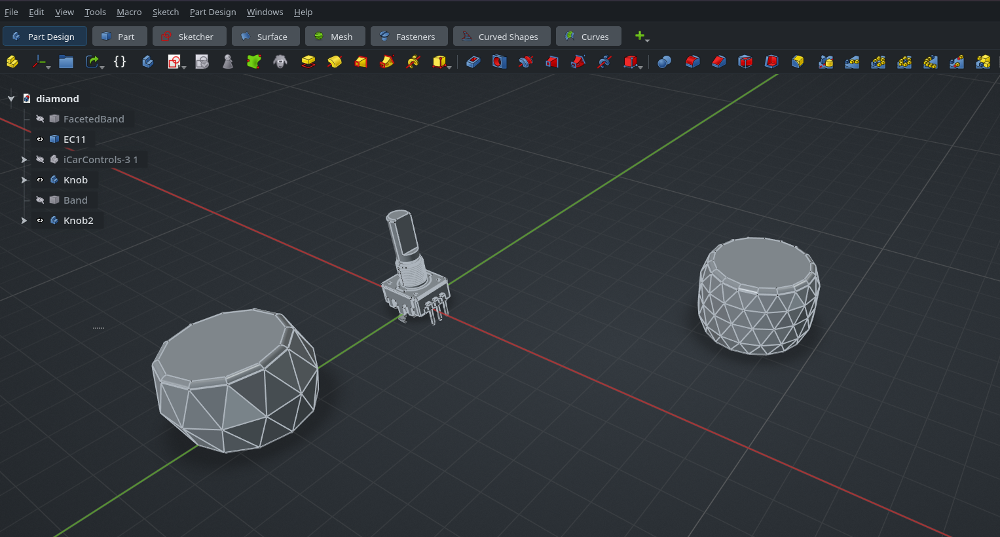

# FerroCAD Grid Overlay (WGSL)



An alternative grid backend for [FerroCAD](https://github.com/ferrocad/ferrocad).
The grid is a single full-screen quad drawn by a WGSL shader: the fragment stage
intersects each pixel's view ray with the z=0 plane and renders anti-aliased,
level-of-detail-blended lines. There is no per-frame Python work: no camera
sensor, no polling timer, no geometry rebuilds.

This repository started as [makzumi's FreeCAD Grid
Overlay](https://github.com/makzumi/freecad-grid-overlay) add-on and has been
ported to the FerroCAD API. It is **FerroCAD-only**: it needs the Coin shader
surface, the pull overlay bridge and the mod provider registry described below.
It does not load on upstream FreeCAD. The original add-on remains the add-on for
upstream FreeCAD; the GLSL shaders and the Qt dialog are gone from this tree.

## What it provides

- **A WGSL grid overlay** — infinite z=0 grid rendered on one quad, with
  automatic level-of-detail blending between minor and major lines.
- **An alternative backend, not a replacement** — the mod registers
  `feature="grid"`, `backend="ferrocad-grid-overlay"` with FerroCAD's provider
  registry at priority 0. FerroCAD's native (semantic) grid declares the same
  feature at priority 10 and stays the default; `Mods_Settings` switches the
  active backend. Only one grid draws at a time, and the inactive backend
  refuses to draw or open its dialog.
- **Six knobs** — show/hide, grid colour, opacity, base spacing scale, ground
  shadow toggle and ground shadow opacity, with the original defaults.
- **Pick-proof and unlit** — the overlay does not interfere with selection or
  picking and uses a base-colour light model, so scene lighting does not affect
  it.
- **Depth-safe** — the blended grid tests the depth buffer with writes disabled,
  so it never hides the shadow beneath it (or the model in front of it).
- **Per-document** — one overlay per open document, attached on create/activate
  and dropped on delete. Only the active document's grid is registered with the
  viewport.

## Requirements

- A **FerroCAD** build that provides all of:
  - the Coin shader nodes `SoShaderProgram`, `SoVertexShader`,
    `SoFragmentShader`, `SoShaderParameter1f`/`3f`/`Array1f`, plus
    `SoFaceSet`, `SoDepthBuffer`, `SoPickStyle` and `SoLightModel`;
  - the pull overlay bridge `FreeCADGui.addOverlay(node)` /
    `FreeCADGui.removeOverlay(node)`;
  - the provider registry `FreeCADGui.registerProvider`,
    `FreeCADGui.activeProvider` and `Mods_Settings`;
  - `pivy.coin` and `FreeCAD.addDocumentObserver`.
- No Qt is required (or imported).

If `addOverlay` is missing, the command reports that the build lacks the bridge
instead of failing at import. If the provider registry is missing, the mod
registers its command and still attaches the overlay as the only grid path.

## Installation

Drop this directory into FerroCAD's `mods/` directory — the directory that sits
next to FerroCAD's `python/` (a packaged install has both beside `AppRun`; a
development checkout uses `mods/` in the repository root). The folder name is
not significant; the module, its `Resources/` and its `InitGui.py` just have to
be one directory.

Restart FerroCAD. `InitGui.py` is executed by the workbench loader, registers
`FerroCADGridOverlay_Settings`, and declares the grid provider.

## Selecting the backend

Open **Mods_Settings** and choose the grid backend:

| Feature | Backend label | Where it comes from |
| --- | --- | --- |
| `grid` | Semantic (native) — the default | FerroCAD's built-in grid |
| `grid` | **FerroCAD Grid Overlay (WGSL)** | this mod |

The choice is persisted by FerroCAD under
`User parameter:BaseApp/Preferences/Mods` → `Providers/grid`. Selecting this
backend runs its `activate` (registers the overlay); switching away runs
`deactivate` (removes it) and restores the native grid.

The settings command is `FerroCADGridOverlay_Settings`
(menu text **FerroCAD Grid Overlay (WGSL)**). It returns the standard dialog
spec and, on accept, persists the values, rebuilds/re-registers the overlay and
asks the shell to redraw it.

| Setting | Description |
| --- | --- |
| Show custom grid | Toggle the procedural grid overlay on/off. |
| Grid colour | `#RRGGBB` colour of the grid lines. |
| Opacity | Overall grid opacity (0–1). |
| Base spacing scale | Multiplier on the base grid spacing (0.01–100). |
| Show ground shadow | Persisted; **does not draw yet** (see Limitations). |
| Ground shadow opacity | Persisted; **does not draw yet**. |

## How it differs from the upstream add-on

| Upstream add-on | This mod |
| --- | --- |
| GLSL 1.20 `grid.vert.glsl` + `grid.frag.glsl` | One WGSL module, `Resources/grid_overlay.wgsl`, carried by the vertex stage |
| `view.getSceneGraph()` and `sg.addChild(root)` | `FreeCADGui.addOverlay(root)` / `removeOverlay(root)` |
| In-place uniform writes into a live graph | `_rebind()` after each change: rewrite the value-copied parameter nodes, rebuild the separator, remove and re-add the same root |
| `QSettings` | `FreeCAD.ParamGet("User parameter:BaseApp/Preferences/Mod/FerroCADGridOverlay")` |
| `QDialog` + `QSlider`/`QColorDialog` + private `QToolBar` | The shell's declarative six-field dialog spec |
| `Gui.addDocumentObserver` + `QMdiArea`/`QTimer` | `FreeCAD.addDocumentObserver` (App-side create/activate/delete) |
| FreeCAD 26.x/27.x | FerroCAD only |

`Resources/grid_overlay.wgsl` is a **byte-identical** copy of FerroCAD's
`crates/ferrocad_wgpu/shaders/grid_overlay.wgsl` (the reference copy). A mod
ships loose files and cannot reach into the crate at runtime, so the duplicate is
deliberate; keep them in sync when the reference changes. Colour tokens are
decoded from sRGB to linear light because FerroCAD's render target is sRGB.

## Limitations

- **Ground shadows are deferred.** The `shadow_count`, `shadow_opacity` and
  `shadow_data` parameters and the shader's 80-slot block are compiled, and both
  shadow knobs persist, but no document-bounds producer is wired yet, so
  `shadow_count` is always 0 and nothing draws. This is the upstream parameter
  set without the upstream footprint scan.
- **No Qt.** There is no toolbar, no `QDialog` and no colour picker; the command
  uses FerroCAD's dialog protocol, so the colour is a hex text field.
- **FerroCAD only.** The WGSL source text, `addOverlay`, `activeProvider` and
  the dialog spec do not exist on upstream FreeCAD. Install the original add-on
  there instead.
- **Settings are in-memory today.** FerroCAD's `ParamGet` is a stand-in without
  cross-session persistence; the mod uses the documented API and gains
  persistence when the parameter backend does.
- **A parameter change re-registers the whole tree.** That is the pull bridge's
  contract, not an oversight; the tree is six nodes.

## Development

The port is covered by a self-contained suite that needs neither FerroCAD nor a
GPU: it installs fake `FreeCAD`, `FreeCADGui` and `pivy.coin` modules, loads
`InitGui.py` by path and checks the dialog shape, the overlay add/remove/rebind
calls and the provider declaration.

```sh
python3 -m unittest discover -s tests -v
```

See `tests/README.md` for the manual integration run against a real FerroCAD
build.

## License

MIT — see `LICENSE`. Copyright (c) 2026 [makzumi](https://github.com/makzumi),
the author of the original FreeCAD add-on; `Resources/grid.svg` and
`Resources/Media/demo.png` come from that add-on.
